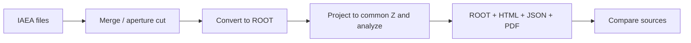

# PHSP Tools

[](https://doi.org/10.5281/zenodo.23989384)

**IAEA phase space → preparation → ROOT → beam analysis → reports → source comparison.**

A C++ toolkit for inspecting particles and scored histories in phase-space files.
ROOT RDataFrame processes records in parallel. Results include ROOT objects, English
HTML/JSON/Markdown reports, SVG figures and multipage PDFs. JSON pipelines combine
merging, aperture selection, conversion, analysis and comparison with live progress logs.

[Quick start](#quick-start) · [Reference plane](#common-reference-plane) · [Pipeline](#json-pipeline) · [Analyses](#analyses-and-interpretation) · [Documentation](#documentation)



## Applications

| Application | Purpose |
|---|---|
| `phspCutter` | Select particles whose forward rays cross a rectangular aperture; write an IAEA pair. |
| `phspMerger` | Concatenate independent IAEA sources while preserving extras and history boundaries. |
| `phspToRootMT` | Convert IAEA to ROOT with ordered records, cumulative history IDs and provenance. |
| `phspAnalyze` | Create particle distributions, beam statistics, scored-history tables and reports. |
| `phspCompare` | Compare distributions using identical bins and a compatible analysis plane. |
| `phspPipeline` | Run the complete workflow from JSON. No Python interface is required. |

## Quick start

Requirements: **C++20**, **CMake ≥ 3.20**, **ROOT ≥ 6.34**, **fmt**, **nlohmann/json**.
Locally tested with ROOT 6.34.04 and GCC 13.3 on Linux x86_64.

With an existing compatible ROOT environment:

```sh
cmake --preset default
cmake --build --preset default
ctest --preset default
```

Alternatively, on Linux x86_64:

```sh
conda env create -f environment.yml
conda activate phsp-tools
cmake --preset conda
cmake --build --preset conda
ctest --preset conda
```

Executables are in **`build/bin/`**. See [building and troubleshooting](docs/building.md).
The Conda test preset supplies the sysroot headers to ROOT's interpreter at runtime;
do not export that header path globally before compiling.

```sh
build/bin/phspToRootMT /data/beam.IAEAheader \
  --threads 4 --extras --output-dir results/beam/conversion

build/bin/phspAnalyze results/beam/conversion/beam.root \
  --threads 4 --bins 120 --energy-max 7 --xy-max 32 \
  --output results/beam/analysis
```

Open `results/beam/analysis/report.html`. Reports work locally without a web server.
The example histogram ranges are not universal: choose ranges suitable for the beam
and inspect overflow. Add `--max 200000` to conversion for a clearly marked preview.

## Common reference plane

**Particle analyses default to a straight-line projection to Z = 100 cm.** This is a
conventional linac reference/isocentre plane **under a target-centred, downstream +Z
coordinate system**. It is a documented convention, not an isocentre inferred from
an arbitrary IAEA file. Published source-model studies compare distributions at the
PHSP surface and at a 100 cm isocentre; [background and assumptions](docs/geometry.md).

Projection uses each particle's actual Z. If IAEA declares constant Z, conversion
reads it from `RECORD_CONSTANT`; otherwise the stored per-record Z is authoritative.
A header's geometry range is recorded as provenance, not substituted for individual
positions. This also handles scoring cylinders or other surfaces with variable Z.

```text
z_reference = z_source + source_z_offset_cm
t = (target_z - z_reference) / dir_w
x_reference = x_source + t*dir_u
y_reference = y_source + t*dir_v
```

Only finite forward-time intersections (`t >= 0`, non-tangential direction) contribute
to particle histograms, moments, profiles, PCA and emittance. The original ROOT file
and original scored-history statistics remain unchanged. Reports state source Z,
reference Z, coordinate assumptions and rejected-ray counts.

```sh
# Choose another common plane or align a known source-origin shift.
build/bin/phspAnalyze beam.root --project-z 100 --source-z-offset 0

# Explicitly inspect the original scoring surface instead.
build/bin/phspAnalyze beam.root --native-plane
```

Vacuum drift does not model air, energy loss, scattering, jaws, an MLC or a phantom.
In particular, projected electrons/positrons are geometric extrapolations, not a
charged-particle transport calculation. Different source origins or orientations
cannot be recovered automatically from blank header descriptions.

## JSON pipeline

Edit [examples/pipeline.json](examples/pipeline.json) for your inputs and ranges:

```sh
build/bin/phspPipeline examples/pipeline.json --progress-seconds 2
```

Paths in JSON are relative to the configuration file; absolute paths stay absolute.
Already converted `.root` inputs skip conversion. The default common target remains
100 cm even when `project_z_cm` is omitted.

```json
{
  "output_dir": "results/run",
  "threads": 4,
  "conversion": {"extras": true},
  "analysis": {
    "bins": 120, "energy_max_MeV": 7, "xy_max_cm": 32,
    "project_z_cm": 100
  },
  "datasets": [
    {"name": "reference", "input": "/data/reference.IAEAheader"},
    {"name": "candidate", "input": "/data/candidate.root"}
  ],
  "comparisons": [{"reference": "reference", "candidate": "candidate"}]
}
```

Open the run's **`index.html`** to navigate all reports. The manifest records requested
and resolved settings and each stage's state. Failures return a nonzero exit code and
retain completed results. Re-running executes the stages again and replaces matching
output files; automatic resume is not implemented.

### Preparation: merge and cut

Standalone commands:

```sh
build/bin/phspMerger /data/part1 /data/part2 --output results/merged/beam
build/bin/phspCutter results/merged/beam results/field/beam \
  --project-z 100 --x-min -7 --x-max 7 --y-min -7 --y-max 7
```

The same operations are available as ordered `preprocessing` entries. Reference a
previous result with `@name`, including from a dataset's input:

```json
"preprocessing": [
  {"name": "joined", "operation": "merge", "inputs": ["/data/part1", "/data/part2"]},
  {"name": "field", "operation": "cut", "input": "@joined",
   "project_z_cm": 100, "x_min_cm": -7, "x_max_cm": 7, "y_min_cm": -7, "y_max_cm": 7}
],
"datasets": [{"name": "selected", "input": "@field"}]
```

The cutter keeps original scoring coordinates unless `--write-projected` is selected.
Both tools write IAEA plus processing provenance, retain history increments and read
all available complete records, including the final one. See [preparation tools](docs/processing.md)
and [legacy integration notes](docs/legacy_tools.md).

## Analyses and interpretation

Each particle group has its own **Distributions and correlations** subsection:
all particles, photons, electrons, positrons, neutrons, protons and other particles.
Empty groups are stated explicitly. Nonempty groups receive a full figure set.

| Analysis | What it shows | How to interpret it |
|---|---|---|
| `energy`, `energy_records` | Weighted kinetic-energy spectrum and stored-record counts. | Distinguish statistical particle representation from the number of stored/split records. |
| `x`, `y`, `xy` | Crossing positions at the analysis surface. | Inspect beam location, width, field shape and tails. |
| Radial counts, density, cumulative graph | Weight in rings, weight per annulus area and radial containment. | Separate halo from the growing area of outer rings. |
| Containment radii and mirror asymmetry | Binned 50/80/90/95/99% radii and reflected-profile differences. | Describe beam extent and symmetry relative to the selected coordinate origin. |
| `theta`, `phi`, backward fraction | Particle directions. | Inspect divergence, preferred azimuths and backward-going records. |
| Energy–radius and energy–angle | Conditional spectral structure. | Reveal spectral changes off axis or with direction. |
| Position–angle correlations | Position versus directional angle. | Look for spatially varying divergence or convergence. |
| Energy crossing map and mean-energy profiles | Sum E·weight and weighted local mean energy. | Separate particle density from changes in energy per particle. |
| Covariance, correlation, PCA | Shared variation of E,x,y,z,r,theta,dir_w. | Identify linear structure not visible in individual projections. |
| Emittance, Twiss, waist | Position/slope moments of +Z-going particles. | Describe geometric beam width/divergence and a free-drift waist estimate. |
| Weights, effective records, quality | Weight concentration, invalid values and overflow. | Assess record statistics and clipping before interpreting distributions. |
| Scored-history multiplicity and energies | Records per original scored group, summed E/E·weight and maximum E. | Describe correlated records at the original scoring surface. |
| Energy by history index | Energy versus record order within the scored history. | Inspect storage order without assuming parentage or interaction timing. |
| Source comparison | Overlays, differences, ratios, TV, Jensen–Shannon and Wasserstein. | Locate and quantify differences between compatible binned distributions. |

**[Full catalogue: object names, units, formulas, interpretation and limitations](docs/analyses.md).**

A history's length is its number of scored records, not track length. Crossing maps
and energy sums are not dose. Record errors and effective counts do not automatically
account for correlations within a history.

## Output files

| File | Contents |
|---|---|
| `analysis.root` | Particle histograms/profiles, correlations, radial graphs and `histories/histories`. |
| `report.html` | English summary and per-species figure sections. |
| `report.pdf` | Multipage figures labelled by particle group. |
| `report.json`, `report.md` | Full machine-readable results and a readable summary. |
| `dataframe.dot` | RDataFrame computation graph. |
| `comparison.root/json/html` | Comparison results and per-species sections. |
| `<base>.processing.json` | Cut/merge lineage, counts and incomplete-history ranges. |
| `*.log` | Stage boundaries, periodic progress, warnings and errors. |
| `pipeline_manifest.json`, `index.html` | Run state, resolved configuration and report navigation. |

`--no-plots` skips SVG/PDF while retaining ROOT and text reports. Output directories
are not automatically cleared; use separate run directories for separate experiments.

## Logging

All applications log to stderr and a file next to the output. The default heartbeat
interval is **5 seconds**. Messages include stage, count, percentage, throughput,
elapsed time and estimated time remaining. ROOT initialization/JIT may hold the count
at zero briefly; heartbeat messages continue.

```sh
build/bin/phspAnalyze beam.root --output results/beam --progress-seconds 2
build/bin/phspPipeline run.json --log-level DEBUG --log-file results/run.log
```

Levels: `DEBUG`, `INFO`, `WARNING`, `ERROR`. `--progress-seconds 0` retains stage
boundaries only. Logs append and use explicitly labelled UTC timestamps. Pipeline
log-file overrides affect its main log; child operations retain their individual logs.

## Integrity and project layout

Incomplete IAEA input requires `--allow-incomplete`. Available complete records are
retained, truncated tails are skipped and full-source normalization is disabled.
Processing provenance preserves incomplete histories inside a merged file as well
as at its final boundary. [Data and history format](docs/data_format.md).

```text
app/                   CLI applications and shared option parsing
core/include/phsp/     public C++ interfaces
core/src/              implementation
core/tests/            synthetic-data tests
core/vendor/           IAEA reader and retained upstream notices
docs/                  analysis catalogue, geometry, formats, preparation and build guides
examples/              JSON configurations and ROOT macros
```

Input data, results, logs and build directories are ignored by Git. Tests generate
their own small fixtures and do not require external PHSP datasets.

## Documentation

The documentation also builds as an **mdBook** with search, chapter navigation and
Mermaid diagrams. The Pages workflow validates pull requests and publishes pushes
to `main`. [Build locally and configure GitHub Pages](docs/documentation.md).

- [Analysis catalogue](docs/analyses.md)
- [Reference-plane geometry and scientific assumptions](docs/geometry.md)
- [Pipeline configuration](docs/pipeline.md)
- [Cutter and merger](docs/processing.md)
- [Data format and histories](docs/data_format.md)
- [Build and troubleshooting](docs/building.md)
- [Architecture and development](docs/development.md)
- [Literature](docs/analysis_references.md)
- [Legacy tools and attribution](docs/legacy_tools.md)
- [Third-party components](docs/third_party.md)
- [ROOT examples](examples/README.md)
- [First release and Zenodo DOI](docs/releases.md)

## License and citation

PHSP Tools is available under the [MIT License](LICENSE). Bundled third-party code
retains its own [licence notices](docs/third_party.md).

If you use PHSP Tools in research, please cite the software using [CITATION.cff](CITATION.cff).

<!-- CITATION:START -->
Use **Cite this repository** on the GitHub repository page to copy a citation,
download [BibTeX](https://raw.githubusercontent.com/jhajduga/phsp-tools/main/CITATION.bib) or [plain text](https://raw.githubusercontent.com/jhajduga/phsp-tools/main/CITATION.txt),
or copy one of the references below. Metadata are maintained in [CITATION.cff](CITATION.cff).

### Plain-text reference

```text
Hajduga J. (2026). PHSP Tools (version 0.3.0). DOI: 10.5281/zenodo.23989384 URL: https://github.com/jhajduga/phsp-tools
```

### BibTeX

```bibtex
@misc{phsp_tools_0_3_0,
version = {0.3.0},
note = {Version 0.3.0},
author = {Hajduga, Jakub},
doi = {10.5281/zenodo.23989384},
month = {11},
title = {PHSP Tools},
url = {https://github.com/jhajduga/phsp-tools},
year = {2026}
}
```

[](https://doi.org/10.5281/zenodo.23989384)

For reproducible research, cite the version you used and its version DOI when available.
[First release and Zenodo instructions](docs/releases.md).
<!-- CITATION:END -->
